# Отчёт «До и после»: интерфейсы Qronion

Состояние проекта: 1468572. Дата отчёта: 4 ноября 2026 года. Объём: изменения этой сессии, начиная с d0fbf44. Исходная точка кода: 7a40063. Интерфейсы сравниваются по смыслу, а не по одинаковому набору рабочих данных.

## Как читать иллюстрации

Исходные снимки пользователя, промежуточные этапы и новые демонстрационные снимки подписаны отдельно. Концепты, которые не были приняты, не включены. Новые снимки показывают текущие HTML/CSS на статических данных; они не заменяют проверку рабочего сервера.

## Сводка

| Экран | Основной результат |
|---|---|

| Вход в систему | Бирюзовый заголовок и фокус, оранжевая кнопка «Войти». |

| Рабочее место оператора | Бирюзовые номера и выбранные разделы, оранжевое главное действие. |

| Уведомления оператора | Цвет всей карточки обозначает статус: красный для ошибки, жёлтый для предупреждения, зелёный для успеха. |

| Терминал: выбор услуги | Сохранены группы, компоновка, центрирование текста и жирность. |

| Терминал: выбор оператора | Заголовок 32 px и название услуги 20 px, оба по центру с жирностью 800. |

| Терминал: ожидание неработающего оператора | Подтверждение внутри существующей модалки: «Оператор сейчас не работает», пояснение об ожидании и действия «Выбрать другого» / «Всё равно получить талон». |

| Основное табло | Строки с разделителями вместо карточек. |

| Медиа-табло | Оформление согласовано с основным табло через общий board-theme.css. |

| Админка: каркас и услуги | Однотонная бирюзовая навигация, оранжевое главное действие и нейтральное добавление группы. |

| Админка: рабочие места и операторы | Пять колонок: ID и логин под названиями. |

## 1. Вход в систему

Экран: `queue/login.html`.

**До:** Синий заголовок, синяя кнопка входа, голубой фокус полей.

**После:** Бирюзовый заголовок и фокус, оранжевая кнопка «Войти». Компоновка и поведение формы сохранены.

До: исходный снимок пользователя. После: снимок текущих стилей без отправки формы входа.

**До**

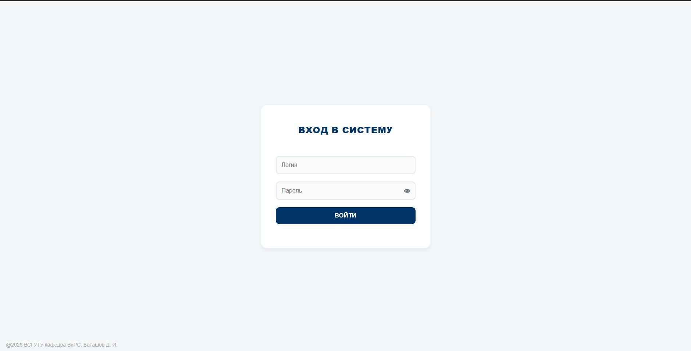

**После**

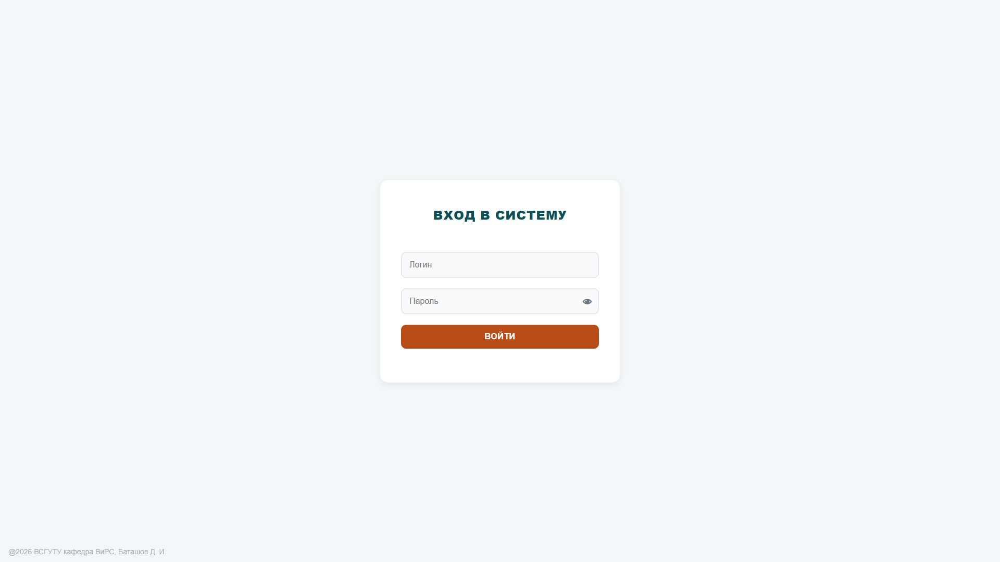

**Проверки:** Изменение палитры. Реальный вход и ошибки авторизации в рамках этой правки не проверялись.

**Коммиты:** 8ef3165.

## 2. Рабочее место оператора

Экран: `queue/operator.html`.

**До:** Команды в верхнем регистре, много жирных второстепенных подписей, синяя главная кнопка. При появлении таймера основное действие смещалось.

**После:** Бирюзовые номера и выбранные разделы, оранжевое главное действие. Команды в обычном регистре. Отступы внутри панелей 24 px, услуги справа выровнены по колонкам. Кнопка занимает стабильное положение между состояниями. Галочки и фокус согласованы с палитрой.

До: реконструкция на демонстрационных данных со стилями из 7a40063; это не снимок рабочего сервера. После: текущие стили с демонстрационным обслуживанием.

**После**

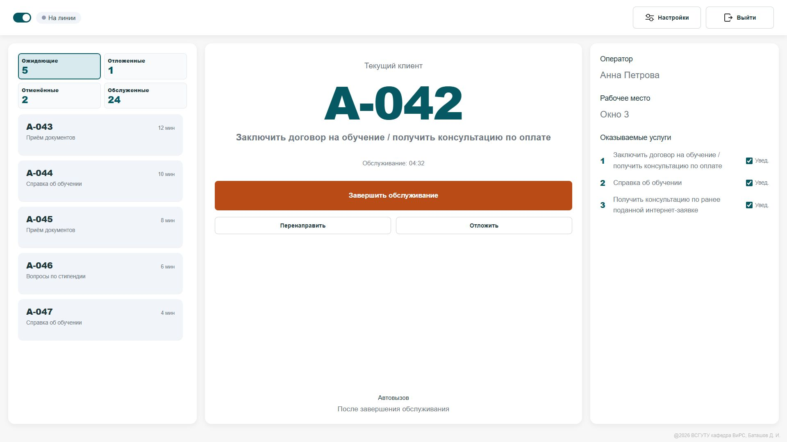

**Проверки:** Проверялись состояния свободен, вызван, обслуживается и перерыв на 1920 × 1080 и 1366 × 768. 38 проверок интерфейса проходили на соответствующих этапах.

**Коммиты:** d0fbf44, a2106ba, af08870, 968e3d0, 6ff5df4.

**До: дополнительный снимок**

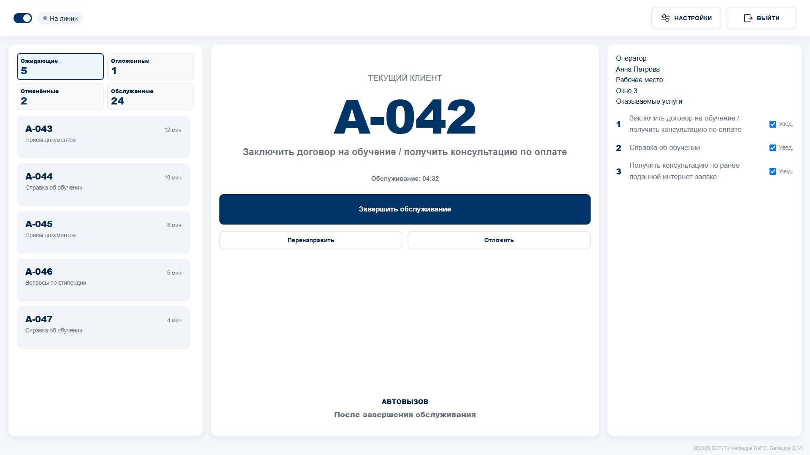

## 3. Уведомления оператора

Экран: `queue/operator.html; queue/js/operator-feedback.js`.

**До:** Однотонная плашка, короткое время показа и резкие сообщения. На промежуточном этапе появился избыточный заголовок «Действие недоступно».

**После:** Цвет всей карточки обозначает статус: красный для ошибки, жёлтый для предупреждения, зелёный для успеха. Значок центрирован. Есть закрытие, ширина зависит от текста, общий заголовок убран. Ошибка остаётся до закрытия; остальные сообщения скрываются через 4 секунды.

Снимок «До» относится к промежуточному варианту перед уплотнением. После: окончательное компактное предупреждение, вызванное настоящим кодом уведомлений на статическом экране.

**До**

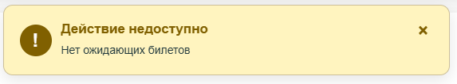

**Проверки:** Проверялись повторный показ, закрытие, таймер и центрирование ранней версии в браузере. Для отчёта окончательное предупреждение дополнительно показано в браузере.

**Коммиты:** a693baf, 5d172b9, ae7bdc4.

**После: дополнительный снимок**

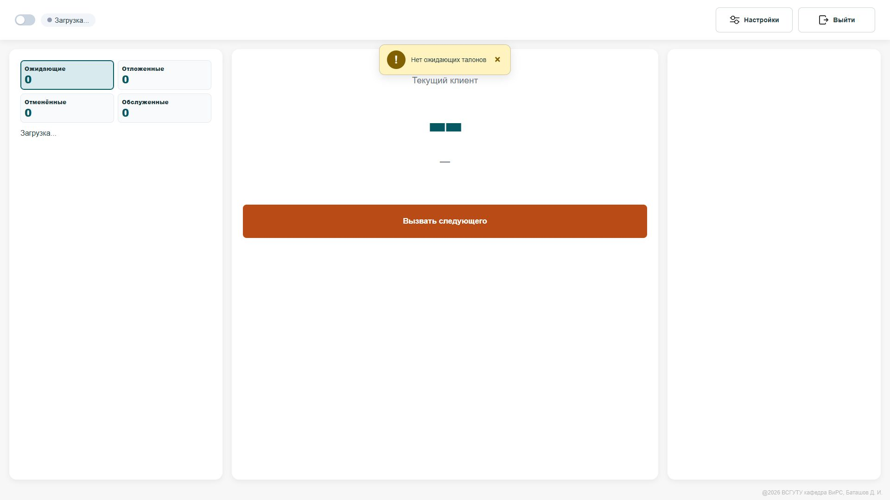

## 4. Терминал: выбор услуги

Экран: `queue/terminal.html`.

**До:** Синие акценты и подъём карточки при наведении, общая анимация всех свойств. Не было viewport.

**После:** Сохранены группы, компоновка, центрирование текста и жирность. Акценты тёмно-бирюзовые, при нажатии карточка оранжевая. Подъём убран, добавлены фокус, режим уменьшенного движения и viewport. Пользовательский оттенок #0c4f57 сохранён.

До: исходный снимок пользователя. После: текущая разметка и стили с демонстрационными услугами; печать не запускается.

**До**

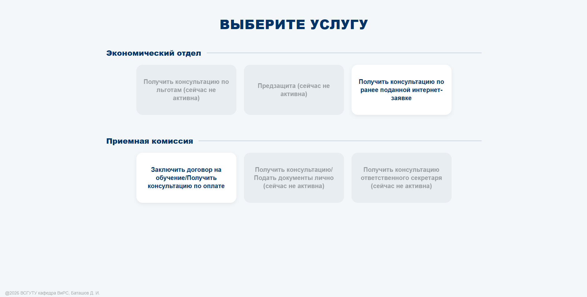

**После**

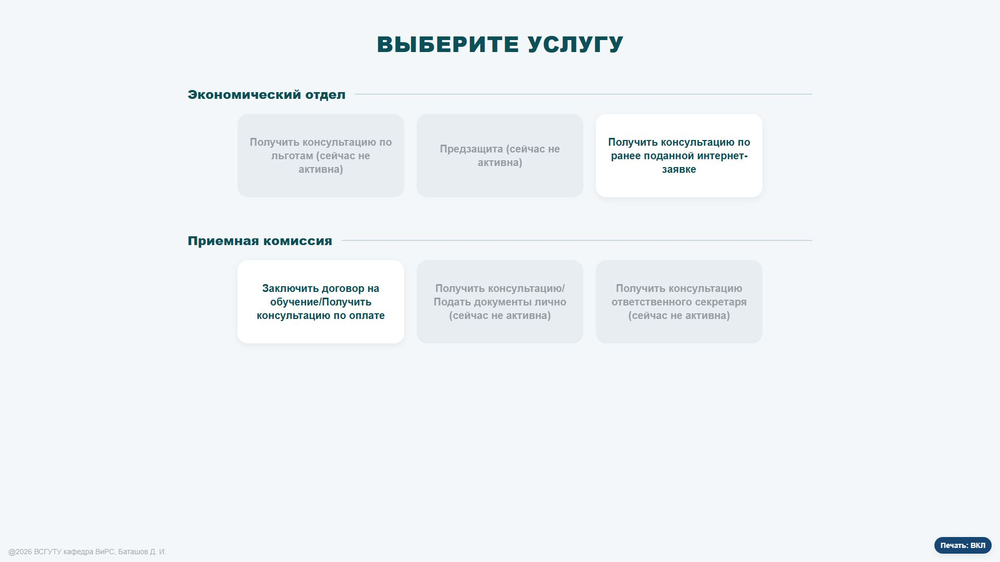

**Проверки:** Проверялись связанные тесты терминала. Адаптивность на физическом терминале и работа принтера не подтверждены.

**Коммиты:** 87a8864, a0fb979.

## 5. Терминал: выбор оператора

Экран: `queue/terminal.html; queue/css/terminal-operator-choice.css`.

**До:** Очень крупные заголовки, центрированные карточки, кнопки выходили за нижний край. Назначение и состояние смешивались в одной крупной подписи.

**После:** Заголовок 32 px и название услуги 20 px, оба по центру с жирностью 800. ФИО и рабочее место рядом, статус ниже. Выбор отмечается кругом и галочкой справа. Список прокручивается, кнопки остаются внутри окна.

До: исходный снимок пользователя. После: шаблон модалки из текущего кода с вымышленными операторами.

**До**

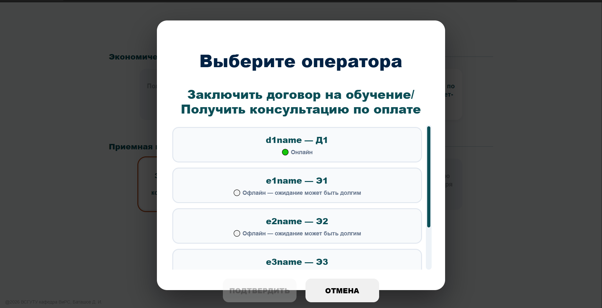

**После**

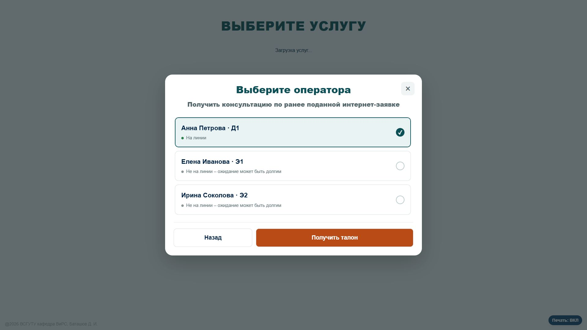

**Проверки:** Добавлена штатная вертикальная сенсорная прокрутка. Проверка пальцем на рабочем устройстве остаётся открытой; перетаскивание мышью не реализовано.

**Коммиты:** a0fb979, eb744c2, 0226b67, 2b4dafd.

## 6. Терминал: ожидание неработающего оператора

Экран: `queue/js/terminal.js`.

**До:** Системный JavaScript confirm с кнопками OK/Cancel и техническим заголовком браузера.

**После:** Подтверждение внутри существующей модалки: «Оператор сейчас не работает», пояснение об ожидании и действия «Выбрать другого» / «Всё равно получить талон». Второе окно поверх списка не создаётся.

До: снимок пользователя. После: текущий шаблон подтверждения, без выдачи талона.

**До**

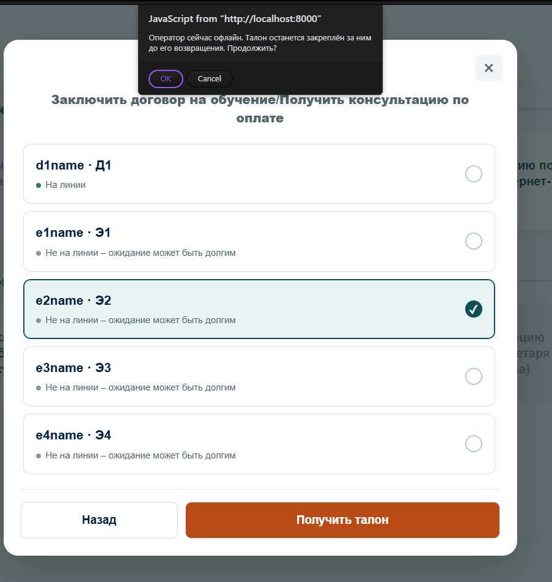

**После**

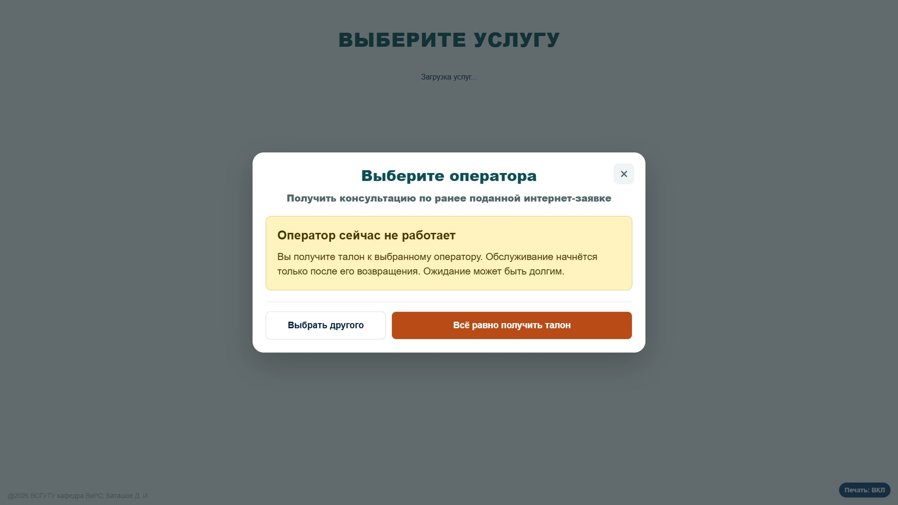

**Проверки:** Проверялись отказ, возврат к выбору, подтверждение и обычный выбор работающего оператора.

**Коммиты:** 16614f8.

## 7. Основное табло

Экран: `queue/board.html; профиль default`.

**До:** Карточки с тенями, синие талоны и коралловые окна, названия разделов «Ожидают» и «Вызванные».

**После:** Строки с разделителями вместо карточек. Заголовки «Ожидайте вызова» и «Подойдите к окну». Шапка по центру; текст #1b3a42, талоны #087582, окна #c65316. Полная дата и время сохранены. Вызов временно мигает насыщенным оранжевым с белым текстом, затем возвращается к исходным цветам. Бегущая строка светлая с оранжевой границей, размер перенесён из медиа-табло.

До: реконструкция обычного табло на демоданных с исходными стилями; не снимок рабочего сервера. После: текущие стили на демоданных. Статический снимок не доказывает правильность последних кадров мигания.

**После**

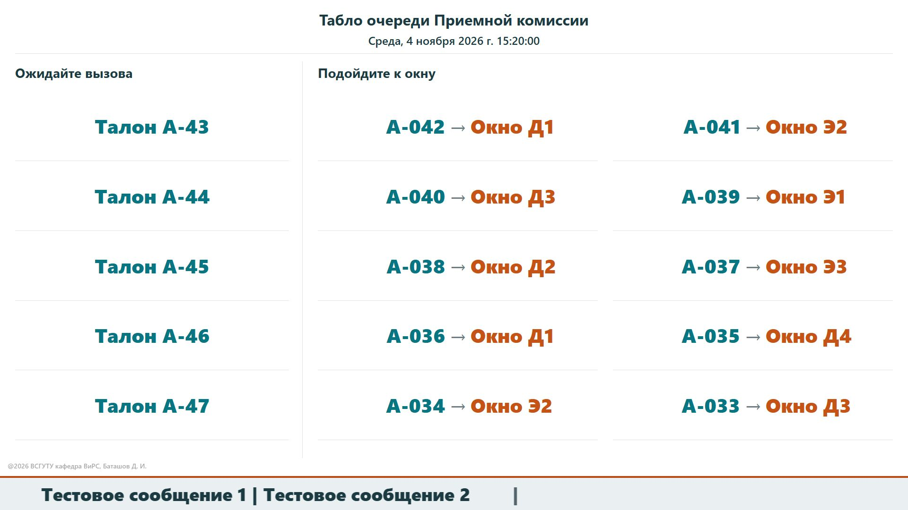

**Проверки:** Проверялись профили, пустые состояния, отложенные и отменённые талоны. Требуется итоговая проверка анимации на реальном телевизоре. Профиль screen=2 не оформлялся.

**Коммиты:** 2753294–f6fc306, 99b421e, cd71c5b.

**До: дополнительный снимок**

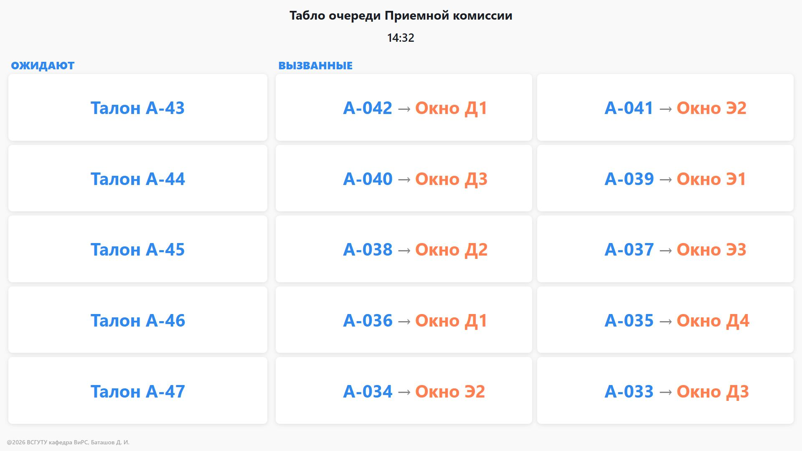

## 8. Медиа-табло

Экран: `queue/board.html?screen=media`.

**До:** Синие талоны, коралловые окна, карточки с тенями. Плашка до перезапуска, таймеры перезагрузки страницы. Сохранялись старые отдельные HTML-страницы.

**После:** Оформление согласовано с основным табло через общий board-theme.css. Видео и звуковые флаги сохранены. Между ожиданием и вызванными добавлен разделитель 1 px; под датой линии нет. Бегущая строка: 72 px, текст 38 px, жирность 800, светлая расцветка. Удалены плашка, перезагрузка и связанное состояние, четыре старые HTML-страницы. Установщик указывает на действующий адрес.

До: снимок пользователя с видео. После: текущие стили и демоталоны; вместо реального видео показана подписанная заглушка.

**До**

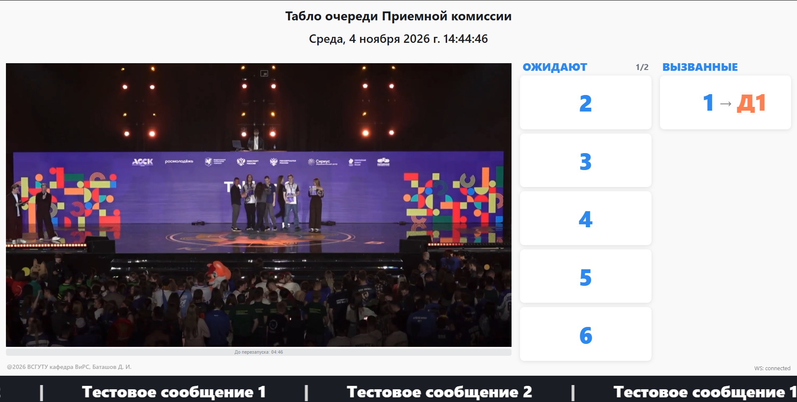

**После**

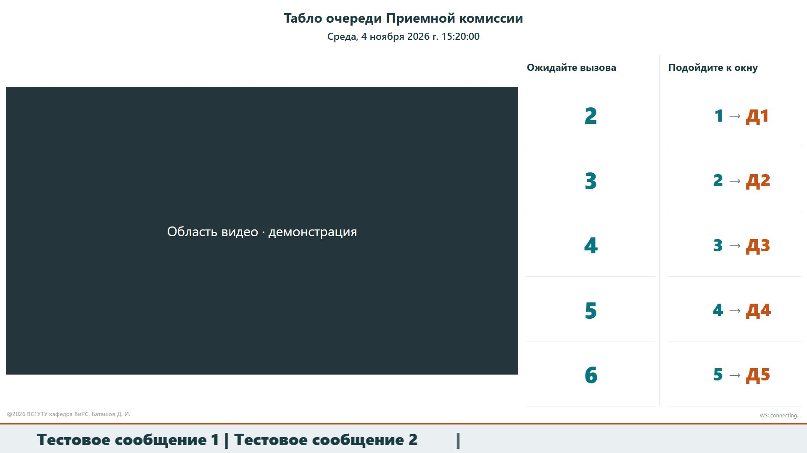

**Проверки:** Проверялись цикл плейлиста, повторное обновление, пустой список и восстановление. Длительное воспроизведение и звук на LG webOS не проверялись. Старые HTML удалены, общие и потенциально используемые ресурсы не удалялись без необходимости.

**Коммиты:** 99b421e, 3d644c2, 4e25c4c, cd71c5b.

## 9. Админка: каркас и услуги

Экран: `queue/admin.html#services`.

**До:** Синий градиент навигации, две равнозначные кнопки добавления и цветные плашки. Статус через dropdown, подписи «Имя» и «Выбор: да». Сохранение услуги отправляло пять запросов. Фокус редактора не управлялся.

**После:** Однотонная бирюзовая навигация, оранжевое главное действие и нейтральное добавление группы. Статусы спокойнее, второстепенные сведения под названием. «Переименовать», понятные подписи и правильные склонения. Статус через переключатель. Сохранение одним запросом и транзакцией. Фокус переносится в редактор и возвращается после отмены; Escape закрывает редактор.

Пара снимков показывает этап до и после исправления удобства работы. Снимок «До» уже содержит новую палитру. После: браузерная проверка на изолированной базе.

**До**

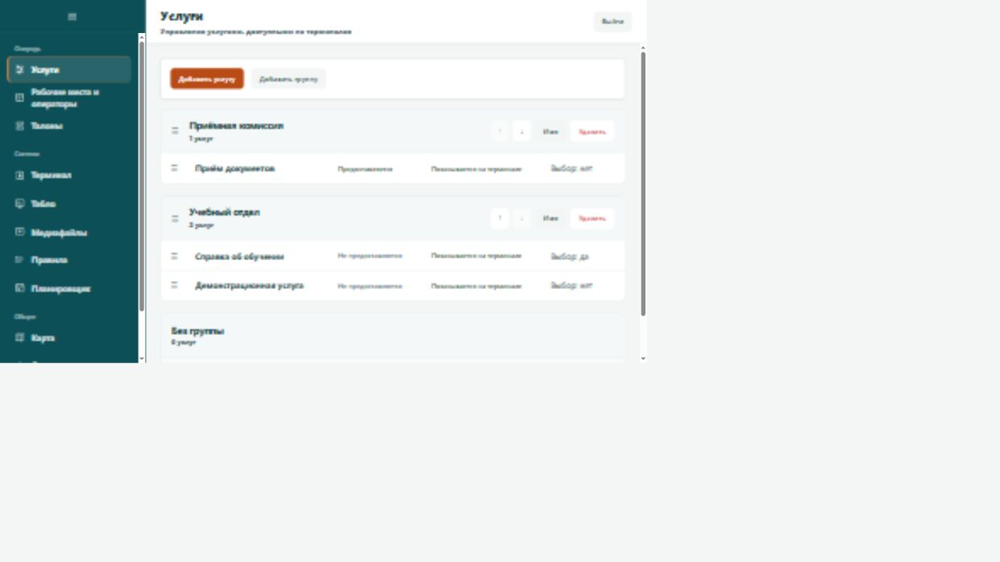

**После**

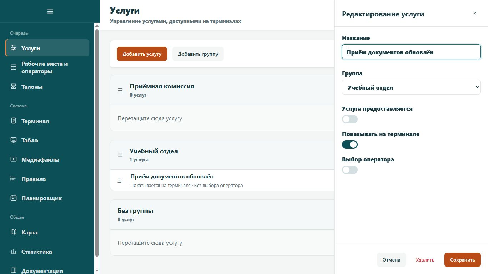

**Проверки:** Добавлены проверки повторного запроса без дублей, совместимости переименования, неверной группы, отката и повторной попытки. SQLite подтверждает откат, но не особенности блокировок PostgreSQL.

**Коммиты:** 8db3e12, c3d28ae, 04041af.

## 10. Админка: рабочие места и операторы

Экран: `queue/admin.html#windows`.

**До:** Восемь колонок, ширина от 1280 px; на 1366 px действия уходили за край. Неясные кнопки «Снять», «Место», «Оператор». Сохранение места в три запроса, назначение могло оставить список заблокированным после сбоя.

**После:** Пять колонок: ID и логин под названиями. Кнопки с полными подписями, второе добавление нейтральное. Поля приоритета имеют собственные названия. Место, статус и услуги сохраняются одной транзакцией; пересчёт доступности переиспользован. После ошибки список назначения доступен для повтора.

До: браузерный аудит уже в новой палитре. После: проверка текущего кода на изолированных данных; в этой проверке рабочие места не имели назначенных операторов.

**До**

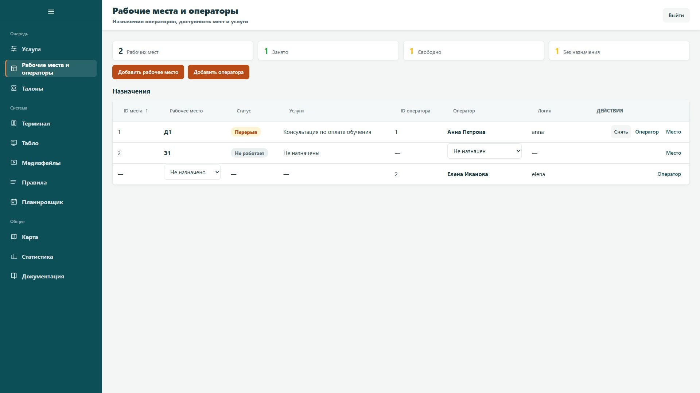

**После**

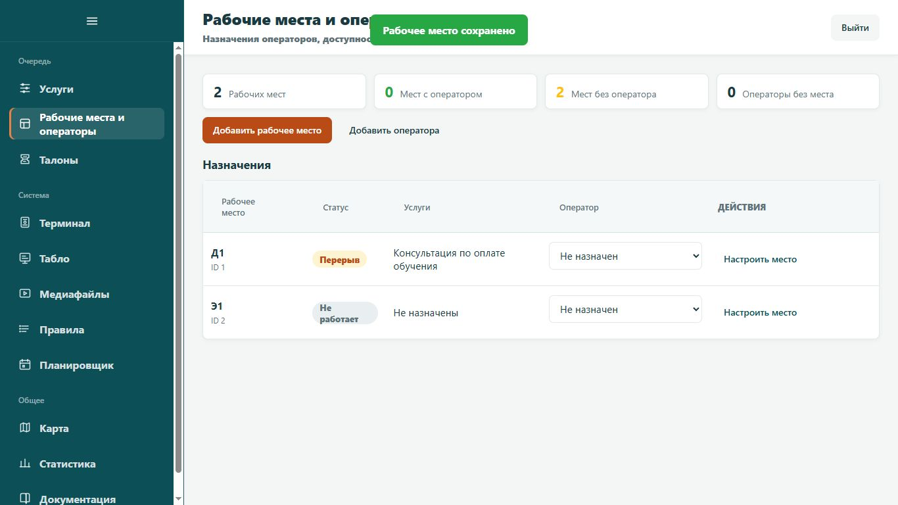

**Проверки:** 55 выбранных тестов прошли на финальном этапе. Проверены откат, повтор без дублирования связей, неверная услуга и приоритет, пересчёт снятых услуг. В браузере таблица и действия поместились на 1366 px. История статусов назначенного оператора на PostgreSQL отдельно не проверялась.

**Коммиты:** 1468572.

## Что осталось проверить

1. Прокрутка списка операторов пальцем на рабочем терминале. Драйвер может передавать касания как мышь. Задача записана в UI_AUDIT.md.
2. Последние кадры мигания вызова, читаемость с расстояния и длительная работа медиа-табло на реальном телевизоре.
3. Печать талонов, звук видео и озвучка в рабочей среде после оформления.
4. История статусов назначенного оператора и конкурентное сохранение на PostgreSQL. Проверки атомарности в отчёте использовали SQLite.

Не проводился полный редизайн остальных разделов админки. Общая палитра затрагивает их каркас, но подробный аудит сделан только для услуг и рабочих мест. Профиль табло screen=2 отдельно не менялся. Числа тестов относятся к отдельным запускам, их нельзя складывать в число уникальных тестов.

## Подход

Unslop: визуальная иерархия, спокойные поверхности и смысловые акценты. Apple-design: понятная обратная связь и предсказуемое поведение. Ponytail: сохранение существующей структуры, общие стили и переиспользование расчёта доступности.

Методика unslop: Damir Sokolovsky, CC BY 4.0. Навыки apple-design и ponytail применялись как рабочие рекомендации, а не как сертификат соответствия.
